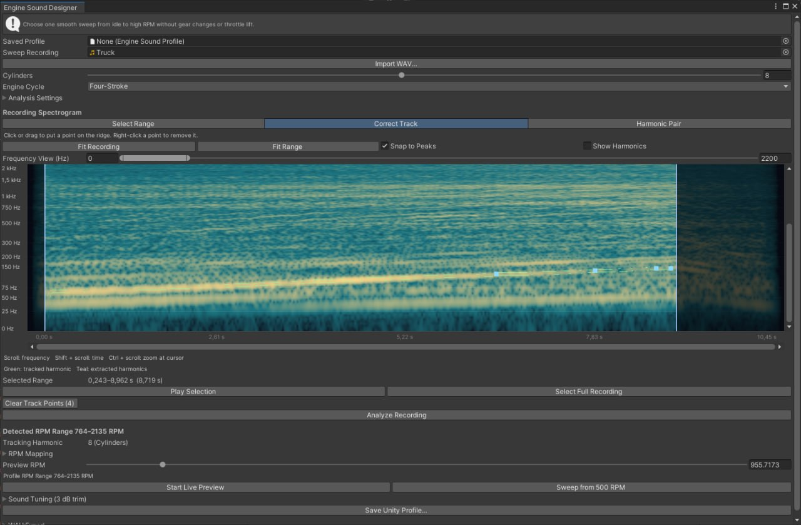

# Engine_Synt_Sim

Turn a single WAV recording of an engine accelerating into a Unity sound profile. The editor estimates RPM and extracts the harmonics, noise, and mechanical detail from the recording. The runtime player synthesizes the result in real time as the vehicle's RPM and engine load change.



## Demo video

Demo video coming soon.

<!-- Replace the line above with [Watch the demo](VIDEO_URL) once the video is published. -->

## Features

- Browse the recording on an interactive spectrogram, select a sweep, and listen to the original selection.
- Track RPM automatically. Refine the track with control points, a harmonic pair, or known RPM anchors.
- Audition the synthesized engine with a live RPM slider and adjust **Noise and Variation** and **Background Noise Trim**.
- Save an engine profile for gameplay or export individual WAV loops and RPM-indexed loop banks.

## Quick start

Tested with **Unity 6.3 LTS (6000.3.13f1)**. Download the repository ZIP and extract it into your Unity project's `Assets` folder. Keep the `Editor` directory structure and Unity `.meta` files.

1. Open **Tools → Engine Sound Designer** and import a WAV or drag an AudioClip into **Sweep Recording**. You can try the included [`lada.wav`](./lada.wav).
2. Set **Cylinders** and **Engine Cycle**. Select a section where RPM rises smoothly and click **Play Selection** to check it.
3. Click **Analyze Recording**. Check the green tracking line on the spectrogram. Use **Correct Track** and **Analyze with Guides** if the line needs adjustment.
4. Click **Start Live Preview** and move the **Preview RPM** slider. When the result sounds right, click **Save Unity Profile…**.

For best results, use a continuous sweep from low to high RPM, with a consistent microphone position and no gear shifts or throttle lift.

## Use in a scene

Add **Engine Sound Player** to your vehicle or start with the included [`EngineSFX.prefab`](./EngineSFX.prefab). Assign your saved profile and configure the `AudioSource` for your scene. From your vehicle controller, pass crankshaft RPM and engine load normalized to 0–1.

```csharp
engineSound.SetEngineState(engineRpm, normalizedLoad);
```

## License

The code is available under the [MIT License](./LICENSE).
